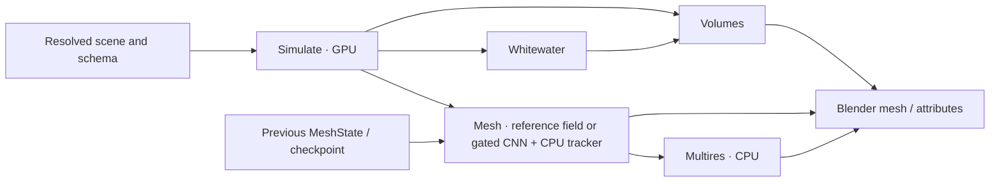

# FluidiTy: product, numerical method, and engineering design

**Status:** The broader product design remains proposed for owner review. The bounded M0 reference and proof foundation has been implemented and reviewed under its implementation plan; this does not approve the full product design.
**Date:** 7 November 2026.
**Canonical companion:** [scientific method source](../../papers/fluidity-method.typ), compiled as `fluidity-method.pdf`.
**Evidence boundary:** this specification selects contracts and experiments. It does not claim an implemented simulator, completed Lean proofs, neural inference results, or measured CUDA performance.

## 1. Purpose and decision authority

FluidiTy is an open-source-ready Blender add-on and native particle–grid simulator for convincing offline liquid effects, beginning with a breaking wave, persistent render surfaces, spray, foam and bubbles. Viscous/multiphase liquids, sand and snow, elastic objects with cutting, and low-Mach smoke/fire follow. The project is sized for one developer assisted by coding agents; every extra representation must justify its correctness and cost.

This is a new, self-contained design. Historical reviews are development records, not normative dependencies. All public technical prose and identifiers are English. The bounded M0 implementation plan covers the reference and proof foundation. Later implementation plans and the broader product design remain subject to their respective review and approval; this document alone approves neither.

Decision labels:

- **Requirement:** owner/product constraint; a builder must not silently remove it.
- **Design:** selected engineering approach, changeable through a recorded ADR with evidence.
- **Experiment:** a bounded comparison; not a promised production feature.
- **Gate:** evidence required before the named capability may be claimed.
- **Deferred:** deliberately outside the initial delivery.

The owner requirements retained here are: one MAC velocity representation; mesh-carried visual sheets below physical resolution; band particles in ordinary caches and full state at checkpoints; foam projected in Geometry Nodes; reduced physical low-Mach gas; fractional viscosity with a coupled solve if measured traction error requires it; two-way rigid bodies with solids; the target hardware below; firm adaptivity with a temporary six-hour uniform fallback; and resolved trapped-air pressure at the extended-liquid milestone. GPU neural reconstruction is a **candidate**, not an exception to measurement gates or a reason to widen the simulation band automatically.

Stable decision IDs used by the companion paper and future ADRs:

| ID | Owner decision |
|---|---|
| D1 | Sub-finest-cell sheets may persist as visual mesh geometry, without claimed physical subgrid dynamics |
| D2 | Ordinary caches contain band particles; full persistent particles belong to checkpoints and optional debug exports |
| D3 | One shared MAC velocity representation |
| D4 | Foam projection is a Geometry Nodes output; Mesh does not consume Whitewater |
| D5 | Reduced physical low-Mach gas with few artistic parameters |
| D6 | Fractional viscosity first; coupled Stokes if the declared traction gate requires it |
| D7 | Two-way rigid bodies arrive with the solid/cutting capability |
| D8 | The reference host is Ryzen 7 9700X, 64 GB RAM, 3 TB disk |
| D9 | Adaptivity is a firm goal; a temporary uniform fallback may take at most six hours |
| D10 | Resolved trapped-air pressure is delivered with extended liquids; earlier collapse is explicitly scoped |

### 1.1 First meshing decision

**Design:** retain a deterministic geometric reconstruction as the reference. The first neural experiment reproduces the published Zhao–Shinar–Schroeder 2025 pipeline on fixed caches, then compares full-volume and actual narrow-band inputs. If accepted, it supplies a render target field to the same persistent CPU tracker. It does not replace simulation geometry or establish mesh identity by itself.

This is simpler than adopting CNN inference, neural interface tracking, train-per-frame hash fields and a new repair algorithm simultaneously. A learned backend is promoted only when it improves measured surface quality within the total job budget. Its code and weight permissions must be established before redistribution; no third-party source or weights are included by this design.

## 2. Scope, audience, and delivery requirements

### 2.1 Reference job

| Item | Requirement |
|---|---|
| GPU | RTX 5060 Ti, 16 GB; CUDA delivery on Windows and Linux |
| Host | Ryzen 7 9700X, 8 cores/16 threads; 64 GB RAM; 3 TB disk |
| Scene | 8 × 20 × 8 m domain; 3 m inlet depth tapering to zero along a 20 m beach |
| Forcing | Second-order Stokes swell, approximately 1 m height and 4 s period; animated paddle as a separate validation variant |
| Sampling | 3.5 cm simulation cells near the fixed camera; adaptivity subject to physical minima |
| Camera | 35 mm, 1920 px, approximately 2 m from breaking point |
| Output | 240 frames at 24 fps, including simulation, surface, whitewater, volumes and requested Multires output |
| Time | At most 10,800 s end to end, including initialization and pipeline drain; temporary uniform fallback at most 21,600 s |
| Preview | Target at most 20 min at twice the cell size without persistent tracking |
| GPU memory | All simultaneous FluidiTy allocations at most `min(0.70 * total, 0.80 * free_at_job_start)`, approximately 11 GB on the reference device |

The three-hour target implies a **45 s/frame average for the complete job**, not a sum of medians with unlimited overlap. No published CNN or MPM speedup is a measurement on this machine.

### 2.2 Supported product surface

**Requirement:** provide Render, Inspect and Preview modes. Render must read baked output without a Python handler per frame. Inspect may use Python for diagnostics. Blender 5.2 LTS is the initial design floor; validate the exact supported version in the first reader spike rather than assuming an untested import API.

Users configure a domain, substances and phase relationships, sources, obstacles (static, animated or deformable), a paddle or Ocean Boundary, and Blender Force/Wind/Vortex/Turbulence fields. Basic simulation controls are limited to six per domain and three per object. Each exposed solver control maps to one consumed schema key and needs an effect test. Each look control maps to one public asset input and needs an evaluation test. The energy control remains one scalar. The Blender workflow and its staged delivery are defined in §§14.2.1 and 15.2.

**Deferred:** full reactive chemistry/oxygen transport, accurate acoustics in the visual solver, physical subgrid-film dynamics, pore-resolved sand/water mixture, damage fracture, a node-editor IR, Metal, distributed multi-GPU production, and a formal proof of the whole simulator. Supersonic flow has reserved interfaces but is a later optional capability, not a low-Mach explosion claim.

### 2.3 Measurable quality contracts

| ID | Acceptance target | Important measurement conditions |
|---|---|---|
| Q-LIQ | Volume drift ≤1% over 10 s; 1 m hydrostatic column speed <1e-3 m/s after 2 s | Account separately for boundaries/sources and physical compression |
| Q-FALL | Free-fall acceleration within 0.1% of g at every energy setting | Unconstrained test with a consistent old/new transfer history |
| Q-PISTON | Displaced volume within 1% of integrated moving-wall flux | Use the same apertures and wall motion in assembly and correction |
| Q-SURF-V | Render mesh volume error ≤0.5% per resolved component | Relative to Simulate's target, not a sum of band particles; report raw and corrected values |
| Q-SURF-N | Rest-tank area-weighted RMS curvature ≤min(0.1/h,3 m⁻¹) | Geometry curvature, stated interior reference region; shading normals are insufficient |
| Q-GRID | Surface-quality variation ≤2% under subcell translation | Add a benchmark-declared absolute floor for near-zero errors; test rotations too |
| Q-IDS | ≥90% eligible IDs survive drop-to-pool outside justified repair; ≥95% in calm motion | Track correspondence and repair area, not just reused integers |
| Q-CAVITY | Deep tank has no false internal shell; genuine enclosed air is retained geometrically | Air pressure may collapse unresolved pockets before the extended-liquid milestone |
| Q-WW | Integrated source difference ≤5% on a frozen field, ≤20% on a scene under h→h/2 | Fixed physical source grid; compare birth time, velocity and age distributions as well as counts |
| Q-SOLID | Uncut stress/deformation work identity within 1e-6 relative/absolute scaled tolerance | Cut/contact work is a separate explicit budget |
| Q-SAND | A 30° dry friction-angle pile settles in the declared 30–35° acceptance range | Specify angle estimator and sampling uncertainty before running |
| Q-GAS | Vortex-ring kinetic energy ≥60% after 2 s | State resolution, boundary conditions and transport variant |
| Q-CAGE | Reference-wave cage target ≤50k quads | Detailed render surface is not capped to the cage count; correctness wins over this negotiable size target |

Small components require a declared absolute volume floor and cumulative lost-volume/count statistics. Conservation in aggregate cannot excuse losing droplets and inflating a pool. Default scenes must produce no warnings; a missing or skipped test is not a success.

## 3. Architecture and data authority



Each stage is a pure state transition over declared immutable inputs plus explicit prior state. Purity does **not** mean Mesh is stateless. The Mesh transition consumes the previous tracked mesh and returns its successor, attributes and repair log. Rebuilding an arbitrary frame with persistent IDs requires a preceding state/checkpoint and deterministic replay.

| Data | Authority and lifetime |
|---|---|
| `sdf_sim`, phase occupancy, pressure fractions/apertures, physical curvature | Simulate only; rebuilt or advanced at the physical substep |
| Grid carrier velocity and interior liquid sign/state | Persistent Simulate state, not cleared with P2G scratch |
| Particle histories, IDs, source counters and topology | Persistent Simulate state with trial versions |
| `sdf_render`, render normals, tracked mesh and repair lineage | Derived Mesh state; never read by Simulate or Whitewater |
| Spray/foam/bubble points and emission remainders | Whitewater state, reading Simulate exports |
| Cage, displacements and LOD correspondences | Multires state derived from validated Mesh output |

Rerunning Mesh must leave `sim/` and `whitewater/` byte-identical and invalidate Multires only. A model/preprocessing change is part of Mesh's fingerprint. Volumes depends on Simulate and Whitewater, not on render-mesh curvature. A render field is derived geometry, not a second physical velocity representation.

### 3.1 Explicit stage interfaces

The plan must turn these conceptual records into versioned schema/types, preserving their ownership:

```
SimulateStep(committed_state, resolved_scene, dt) -> TrialStep
AcceptOrReject(committed_state, trial) -> committed_state | typed_failure
Adapt(committed_state, capacity) -> adapted_state | typed_failure
Mesh(sim_frame, motion_interval, previous_mesh_state, surface_backend, config)
    -> mesh_result, next_mesh_state, diagnostics
Whitewater(sim_events, motion_interval, previous_whitewater_state, config)
    -> points, next_whitewater_state
```

`MotionInterval` describes transport over an output interval, not merely its endpoint velocity. Start with timestamped velocity samples and declared interpolation on fixed caches. Increase sampling only when an advection-error benchmark requires it; compare a compact transport map if storage dominates. The held-field/time-interpolation error must be measured on folding surfaces. Exporting all substeps without a storage budget is not an accepted default.

## 4. Numerical conventions and the shared grid

### 4.1 Definitions

SI units are mandatory in equations, traces and types. Liquid/phase-a signed distance is negative inside. `n = ∇φ/|∇φ|` is outward, `κ=∇·n`, and a spherical liquid drop has `κ=2/R>0`. At a→b interfaces `[q]=q_b−q_a`. Cauchy stress is `σ_C`; surface tension is `σ`; Kirchhoff stress is `τ=Jσ_C`. `V0` is reference volume, `V=JV0` current volume. Plain `J_p` is particle volume ratio; `J_f` is a pressure jump and must have a different typed identifier in code.

A continuum selects equations and state: Liquid, Granular, Snow, Elastic, Gas. A substance supplies parameters. A phase identifies an immiscible region; a body identifies a contact-connected object. Miscible composition uses **volume fractions**, with conversion through the selected mixture law when constituent mass is needed.

### 4.2 MAC placement and hierarchy

**Requirement:** one staggered MAC grid for all velocity components and continua. Pressure and scalars are cell-centered; velocity component a lives on faces normal to a. Solids use staggered MPM. The first implementation uses uniform quadratic B-splines on each shifted face lattice.

**Design candidate for adaptivity:** sparse 4³-cell blocks, 2:1 neighbor grading, THB transitions with quadratic transverse and cubic face-normal functions. Uniform quadratic moments are `D_a=h²I/4`; cubic-normal moments are diagonal with `h²/3` normal and `h²/4` transverse. Full transition moments use Greville positions. The cited evidence does not validate this entire adaptive 3D GPU combination: it is an explicit spike/gate. If nesting, reproduction or cost fails, test a box-based GIMP/AG-MPM alternative. A uniform sparse+narrow-band fallback may temporarily meet the six-hour target; adaptivity remains an open requirement, not silently removed.

A block owns 64 cells and 3×64 low faces; high faces have unique neighbor owners. Pressure T-junctions use a single consistent subface flux representation: coarse flux equals the sum of fine physical fluxes. Do not count both independent coarse and fine unknowns on the same aperture.

The common particle bin is `B_d=floor((x_d/h−1.5)/4)` at the last sort. Under per-axis displacement ≤0.5h, uniform quadratic/cubic support lies within `[4B_d,4B_d+8)`. Every contribution checks inclusion **before writing**. Actual THB supports need separate allocation/inclusion checks; a uniform theorem is not permission to omit them. A global i64 deposit is permitted only onto allocated owned faces; otherwise reject the trial.

## 5. The physical substep

Choose dt from committed state and a source/obstacle preview without consuming IDs. At a frame end set `n=ceil(remaining/dt_max)`, `dt=remaining/n`, avoiding a tiny residual step. Dynamic bounds are checked again before unsafe access and before acceptance.

| Step | Operation | Required ordering/state contract |
|---|---|---|
| 1 | Emit | Frozen dt; deterministic source/child ordinals and IDs in the trial |
| 2 | Sort, activate, reset | Stable sort; allocate all actual support; reset scratch before any P2G write |
| 3 | P2G | Compatible normalized mass/pure momentum and separate force, all quantized per contribution in i64 |
| 4 | Normalize and snapshot | Low-mass validity now determined; blend the Eulerian overlap; save pure velocity before every force |
| 5 | Apply grid forces and gas thermodynamics | Solids/liquids receive their specified gravity; low-Mach gas receives residual buoyancy, not an additional full gravity |
| 6 | Waves | Ocean Boundary and absorbing relaxation after the snapshot |
| 7 | MPM body contact | Per-body face velocities and reactions; fluid wall flux remains in pressure |
| 8 | Interface | Geometry at frozen xⁿ: Simulate SDF, fractions, apertures, κ, θ, jumps, density/compliance and sources |
| 9 | Viscosity | Same full-grid tensor operator in both branches; spectral certificate or implicit fallback |
| 10 | Pressure | Compatibility/gauge by mode; solve; correct with the same coefficients; last physical write to grid velocity |
| 11 | Ghosts and G2P | Separate old/new complete samples; affine fit C; true L; deformation/return; separation; stored/advecting contact; continuous collision |
| 12 | Whitewater events | Trial birth events with occupied-volume-weighted strength and accepted-time identity |
| 13 | Validate/accept | True residuals, finite/admissible state, displacement and inventories; swap all versions and advance clock once |
| 14 | Adapt | Separate transaction after acceptance; refusal retains the parent/old topology, not a half-applied remap |

Disabled operators are identities. A dependency graph must encode activation/reset→P2G, interface→viscosity→pressure, snapshot→old ghost construction, and acceptance→adaptation. A chart's spatial layout is not an execution barrier.

### 5.1 Transfer equations

For component a, let the complete basis have sample positions x_ia and offsets `r_ipa=x_ia−x_p`. Compatible P2G pairs exclude the wrong side/body and unavailable structural samples, **not** faces whose mass has not been deposited yet:

```
S = Σ_compatible N;       N' = N/S
∇N' = (∇N − N' Σ_compatible ∇N)/S
μ_pa = Σ N' r;           r' = r−μ_pa
D'_pa = Σ N' r' r'ᵀ
m_ia += N' m_p
q_ia += N' m_p (v_pa + c_affine,pa · r')
f_ia += −V0_p (τ_p ∇N')_a
u0_ia = q_ia/m_ia on valid faces; snapshot v_old = blended u0
```

Liquid/Gas return zero **particle** stress: physical viscosity is on the grid. Solids return Kirchhoff stress. `C` stores an affine fit, not a support-dependent B moment and not generally the true velocity gradient L.

G2P uses the **complete original basis** with actual or ghost sample arrays `û_new` and `v̂_old`:

```
D_full,pa = Σ_complete N r rᵀ
v_pic,a = Σ N û_new,ia
δ_a = v_pa − Σ N v̂_old,ia                 before overwriting v_p
c_pa = D_full,pa⁻¹ Σ N û_new,ia r
L_p = Σ_a e_a Σ_i û_new,ia (∇N_ipa)ᵀ
F_trial = (I + dt L_p) F                  solids
(F, history) = ReturnMap(F_trial, history)
J_p ← J_p exp(dt tr L_p)                  Liquid/Gas
v_p = v_pic + αδ
v_adv = v_pic + β_p αδ
```

Require partition/first/derivative moments for claimed affine reproduction. Ghosts are built independently from the pre-force and final fields using same-side/body data, rank checks and matching wall times. A boundary-normal replacement reproduces only fields compatible with that boundary. Insufficient rank/ill-conditioned moments cause a counted PIC fallback; test before division/inversion. `kAffineOff` makes every affine consumer read zero, although the persistent C slot may hold diagnostic L. Do not infer L from ordinary C.

An identical old/new grid gives a zero **grid increment**, not necessarily δ=0. A particle touching an Eulerian low-mass fallback face explicitly sets δ=0. Newly initialized particles have a declared consistent old history or start PIC.

The energy control is `e∈[0,1]`, `α=0.99e`, `β_max=e`, default e=0.6. Elastic always has β=0. Liquid surface separation uses positive expansion and proximity to its interface, excluding obstacles; granular/snow uses returned admissible state outside contact. This ASFLIP-inspired separation policy is a design approximation with its own effect tests, not an automatic guarantee of energy monotonicity for every scene. Require the specified dam-break look-book test.

The initial Gas validation baseline is APIC with α=β=0; it does not borrow a liquid free-surface separation test. Any later gas energy blend has a separate effect/transport gate, and unavailable controls are not exposed as functioning settings.

### 5.2 Contact and work

On uncut supports, true ∇N pairs stress force and deformation: `Σu·f=−ΣV0 τ:L`. On cuts, compatible deposition uses ∇N' while the complete ghost gather uses ∇N; record `ΔW_cut=dt ΣV0 τ:(L−L')`, momentum/torque changes and blade work. No theorem of exact internal energy conservation is claimed there. A velocity replacement's reaction is counted once; an arbitrary scalar work residual is not converted into a fabricated impulse.

Contact constrains both v_p and **v_adv**. Store incoming normal velocity before setting the outgoing normal part to zero; Coulomb friction uses that incoming impulse. For moving obstacles use continuous collision: conservative advancement with certified distance error, spatial Lipschitz and relative-motion bounds, or continuous swept-BVH geometry. Fixed 0.25h sampling can miss a thin wall and is not an accepted certificate. Failed advancement/certificate falls back or rejects; final position projection repairs tolerance penetration, not tunnelling.

MPM faces may hold up to four body velocities in a sparse table; overflow is `E-CONTACT-BODY-CAPACITY`. Fluid/body pressure loading is initially partitioned, with a declared one-step lag, added-mass diagnostic and floating-body test. Light-body failure gates a coupled solver. Blender obstacles are one-way until the two-way-rigid milestone. Use geometric unions for overlapping blocked regions or veto ambiguous overlap; summing overlapping solid fractions is not exact union geometry.

Two-way rigid body state is explicit in its body table: mass, body-frame inertia, center, unit orientation, linear/angular velocity and force/torque accumulators. Pressure force is `−Σ p_f A_blocked,f n_body,f`, with contact reactions counted once; torque is `Σ(x_f−center)×force_f`. With `I_world=R I_body Rᵀ`, integrate `dv/dt=F/m`, `dω/dt=I_world⁻¹(T−ω×I_worldω)` and orientation consistently with world angular velocity, preserving a normalized quaternion. Check positive inertia/mass and checkpoint pose/history. A translational velocity update alone is not a complete rigid-body integrator; support and rotation sweep bounds use the same pose evolution.

## 6. Pressure, viscosity, and capillarity

### 6.1 Integrated pressure system and metric

Orient a face i→j. Its open area is `a_f=A_f |f|`, center/interface distance d_f, mobility β_f, and conductance `k_f=dt a_f β_f/d_f`. Outward incidence R has +1 at tail i and −1 at head j. `D=R diag(a)` is **integrated outward divergence**. The integrated gradient is `G_int=−Dᵀ`; physical pressure force is `−G_int p=+Dᵀp`. A transpose identity without this metric/sign convention is insufficient.

Use positive face inertia `M_ff=a_f d_f/β_f` on unconstrained pressure links. This is the selected effective dual-volume quadrature, also used by the matching viscous velocity update; it is not assumed equal to particle quadrature mass. Then `dt D M⁻¹Dᵀ=R diag(k)Rᵀ`. Zero-area/mass degrees of freedom are eliminated or prescribed, never inverted.

For cell volume V_i, divergence source s_i and compliance `C_i=V_i/(K_i dt)`, assemble

```
Σ_unknown k_f(p_i−p_j) + Σ_Dir k_f p_i + C_i p_i = b_i
b_i = V_i s_i − Σ_f a_f u*_f n_if − Σ_f (|f|−a_f) u_obst,f n_if
      − Σ_unknown k_f J_f + Σ_Dir k_f p_Γ + C_i p*_i
u_f = u*_f − (dt β_f/d_f)(p_j−p_i−J_f)
```

Use the same area, mobility, distance, jump and wall flux in assembly and correction. Dirichlet terms use the appropriate boundary pressure; sealed-component walls are not fictitious zero-pressure faces.

- Same material: β=1/ρ with a declared face interpolation. A mixture uses its current density law.
- Two phases: if θ of the link lies in i, `β_f=1/(θρ_i+(1−θ)ρ_j)` (series resistance).
- Free surface: interface distance θd, `θ=φ_i/(φ_i−φ_j)` regularized to at least 0.05; log the regularization. Use `p_Γ=p_gas,gauge+σκ` and **J_f=0 on that Dirichlet link**. Equivalently an implementation may lift gas pressure and capillarity through a boundary jump, but then it must not also put σκ into p_Γ. Ambient gas has zero gauge pressure; a cavity supplies its own gas pressure.
- Jump convention: `[p]=[2μ n·D(u)n]−σκ`; J_f is [p] or −[p] according to orientation. Initial split viscosity omits the viscous jump as an explicit measured approximation, not an exact Stokes solve.

Let `A=L+C+R_Dir`, with `L=R diag(k)Rᵀ`. It is PSD; it is SPD only after each otherwise-null connected component is anchored or gauge-restricted. Pure Neumann components with C=0 require `ΣV_i s_i = total prescribed wall flux`. Remove only the correction source's compatible mean, evolve the separate thermodynamic gas pressure where applicable, or reject an incompatible physical RHS without dt retries. A component with positive compliance retains its physical mean pressure and gets no arbitrary pressure pin.

For true residual `r=b−Ap`, final constraint defect is

```
div_h u − s = −(p−p*)/(K dt) − r/V
```

with the compliance term zero in incompressible mode. Require global residual tolerance **and** a volume-scaled local residual bound; integrated residual alone hides small-cut-cell errors. Recompute the true residual after PCG. Use FP32 vectors/products and FP64 reductions/coarse arithmetic, matrix-free multigrid and mirrored symmetric coefficients. Pressure failure retries dt at most twice, then stops. Warm-start pressure is versioned persistent state.

### 6.2 One viscous operator

For strain `Eu−d_wall`, define `K_μ=EᵀW_μE`, `b_wall=EᵀW_μd_wall`, `W_μ=2μV` with off-diagonal strain multiplicity included. E, quadratures and the positive face inertia M must be consistent with the chosen geometry and pressure metric. Tensorial `2μD(u)` is not replaced by independent component Laplacians at a traction-free boundary.

```
Explicit: u_new = u* + dt M⁻¹(b_wall−K_μu*)
Implicit: (M+dt K_μ)u_new = M u* + dt b_wall
S_μ=M⁻¹/²K_μM⁻¹/²
Λ_μ=max_f Σ_g |S_μ,fg|, with conservative assembly/rounding enclosure
```

Select the explicit branch only if `dt Λ_μ≤2(1−ε_stab)` for the **whole coupled component**; otherwise implicit. If no reliable bound is available, choose implicit. The shortcut `νdt/h²≤1/12` is a regular uniform constant-coefficient tensor-stencil oracle, not a cut-cell/AMR guarantee. PSD K alone does not guarantee explicit dissipation. Stationary homogeneous boundaries give the exact-real energy claims in formal contract F7; moving walls add measurable work. No independent per-material rowwise mixing of time integrators is allowed.

Run viscosity before pressure. The final velocity satisfies the **selected** constraint (incompressible/source/compliant), not invariably zero divergence. Measure fractional traction error on extension/Couette and high-contrast liquids; adopt a coupled Stokes system if the quality gate fails. Non-Newtonian models, when activated, use a regularized positive effective viscosity in this same operator and revalidate the branch bound.

**Traction promotion gate:** before running, fix analytic or independently converged coupled-Stokes references for planar extension and Couette, including viscosity ratios1,10 and1000. Measure area-weighted RMS and maximum errors in normal/tangential interface traction, normalized by a fixture-declared nonzero stress scale such as2μ_ref U/L; state the absolute floor for vanishing reference traction. Initial design tolerance is5% RMS plus a declared maximum bound, checked at two resolutions and smaller dt. Record the thresholds with the fixtures; do not tune them after seeing results. Exceeding the accepted traction/visible-shape error promotes the coupled solver before the viscous feature passes.

### 6.3 Surface tension

Simulate computes κ and interface geometry each physical substep from its own field. Apply capillarity once as the pressure jump. Do not also add a full equivalent area force. The explicit bound is `dt≤sqrt((ρ_a+ρ_b)h³/(4πσ))` over active interface levels. A later semi-implicit version needs its own linearization and evidence.

Validate a static sphere with jump2σ/R, parasitic-current convergence, and drop mode l:

`ω_l² = l(l−1)(l+1)(l+2)σ / (R³[(l+1)ρ_in+lρ_out])`.

The l=2 frequency target is ±5% at declared amplitude, resolution and damping. Contact-angle physics is not supplied by contact friction; variable σ/Marangoni is deferred. Learned render derivatives do not enter this operator.

## 7. Particles, Eulerian interior, and adaptive remapping

### 7.1 Narrow-band ownership

Liquid particles occupy a surface band; deep liquid is Eulerian. Define inner band depth e_b in meters from the simulation interface, with support, movement and reseeding margin; the initial candidate is 6h. A 2h overlap blends particle and Eulerian carrier velocities **before** the old-grid snapshot. Low-mass liquid faces use the valid Eulerian carrier and explicitly reset affected particle residuals to PIC. SDF advection may use BFECC, but a semi-Lagrangian sign field is not an exact conservative mass ledger.

Simulate owns persistent occupancy/sign, physical source/boundary inventories and component lineage. Output volume targets come from that state and the source/flux ledger, not ΣJV0 of band particles. Count each physical region once even where both carriers overlap. Track geometric occupancy drift against the ledger. On component splits assign the parent target through documented overlap/occupancy weights summing to one; on merges sum targets. Report the uncertainty and cumulative small-component loss. Finite-c target volume must reflect mass/EOS compression instead of imposing the incompressible constant-volume ledger.

The Python reference must validate band/core handoff on a deep tank, translating interface, descending surface and true closed cavity before the production narrow band can pass. Do not fill every cavity merely because its particles are absent.

Reseed only fully liquid cells initially. For current owned volume V, current density ρ and n points:

`J=EOS.VolumeRatio(p)`, `V0=V/(nJ)`, `m=ρV/n`.

Initialize v and affine C on the destination support, distinct from L; transfer constituent inventories and enthalpy with the same ownership rule. Logs prove no duplication during handoff. Partial-cell reseeding is a later extension requiring an explicit quadrature rule.

### 7.2 Split, merge, and retained particles

Split/merge applies only on certified uniform **unmasked** supports away from THB, obstacles and cuts. Refuse ill-conditioned moments, affine-off flags, wrong phase/body/side or children outside valid fine support. Refusal retains a valid parent quadrature point.

For symmetric 1→8 offsets with covariance S: `m_c=m/8`, `V0_c=V0/8`, `x_c=x+δ_c`, `v_c=v+Cδ_c`; retain C,J and admissible history. Uniform quadratic 2:1 uses `S=3h_coarse²I/16`. For cubic-normal MAC choose that common S and account for row residual `R_a=h_coarse²e_a e_aᵀ/16`. Mass/volume/linear and staggered angular moments remain exact under the stated hypotheses, but energy loses **`m h_coarse² Σ_a C_aa²/32`**. Do not describe this cubic split as exactly energy preserving.

Merge at most eight Liquid/Gas points with matching phase/substance/body; never merge Elastic/Granular/Snow history. For each row a:

```
M=Σm_c; xbar=Σm_c x_c/M; vbar=Σm_c v_c/M; r_c=x_c−xbar
K_a=Σm_c(r_c r_cᵀ+D_c,a)
H_a=Σm_c[(v_ca−vbar_a)r_cᵀ+c_ca D_c,a]
c*_a=H_a D*_a⁻¹/M
```

Accept only if each `M D*_a−K_a` is PSD with positive-definite support moments. This is a sufficient dissipative gate, not an obligation to merge every group. Set `V0*=ΣV0`, `J*=ΣJ_cV0_c/V0*`; volume-fraction composition uses current-volume weights `J_cV0_c`, not mass weights. Log the actual energy loss and all inventories. These algebraic conservation formulas do not establish thermal/mixture EOS admissibility: verify the target against the selected material state and declared tolerances, or refuse the merge.

Keeping C on a retained particle preserves its affine field, not its support-dependent energy/spin. Record `ΔE=(m/2)Σ_a c_a ΔD_a c_aᵀ` and the corresponding row angular moments; veto coarsening if the declared local defect budget is exceeded. Initial energy budget is1% of block kinetic-plus-affine energy, subject to measurement; angular defect has its own recorded tolerance. Never silently count these numerical changes as physical dissipation.

### 7.3 Grid coarsening

Requested h is an **upper bound**: `h_req=min(h_physical,h_interface,h_support,h_camera,h_max)`. Refine immediately when h>h_req. Coarsen siblings only when `2h≤0.8 h_req` over parent plus actual support/movement halo for uninterrupted accepted physical hysteresis time. Reset the counter on a veto. Unresolved cavities/sheets/gaps<4h, cutting/contact bands and singular moments veto coarsening. Camera distance may request more detail, never override physical minima.

Restrict extensive state by sums, recover intensive values from conserved quantities, sum fine fluxes onto coarse faces, and use conservative limited prolongation. Recompute temperature from enthalpy and pressure from the chosen state/EOS policy. Keep material constants physical: do not retune μ,σ,Lamé/friction merely because h changes. Hysteresis, topology and remap states are checkpointed. Scalar positivity and source inventories are separate checks from interpolation smoothness.

**Adaptive promotion gate:** require dimensionless partition and linear-moment defects≤1e-6 in FP32 on uniform/transition patches, a constant-pressure integrated relative residual≤1e-6, and the same volume-scaled divergence limit as the pressure solver. Use cell width to nondimensionalize position moments and state the absolute floor of the relative residual. Test translation/rotation, negative coordinates, both kernels, coarse/fine flux ownership and masked fallback separately. Measured defects and throughput determine whether the THB candidate passes; a smooth image is not the gate.

## 8. Other materials and time-step bounds

### 8.1 Constitutive state

| Continuum | Additional particle state | Constitutive operator |
|---|---|---|
| Liquid | J, optional constituent volume fractions | Pressure/EOS and grid viscosity; no particle pressure stress |
| Elastic | F, body, persistent cut labels | Neo-Hookean default or corotational law |
| Granular | F_E, log J_pl, body | Hencky elasticity plus Drucker–Prager return |
| Snow | F_E, log J_pl, body | Corotational elasticity, clamped singular values and hardened moduli |
| Gas | J/marker metadata; optional transport-map state | Grid thermodynamics and particle-carried velocity/impulse transport |

For solids use stress per reference volume, `τ=(∂W/∂F)Fᵀ`, depositing `−V0 τ∇N'` without another factor J. Neo-Hookean: `τ=μ(FFᵀ−I)+λ lnJ I`. Corotational: `τ=2μ(F−R)Fᵀ+λ(J−1)J I`. Require positive determinant and an admissible material domain.

For granular `F_E=UΣVᵀ`, `ε=lnΣ`, `τ=U(2με+λ trε I)Uᵀ`. Let `t=trε−c_coh`, deviator εhat and `α_DP=sqrt(2/3) 2sinφ/(3−sinφ)`. Treat the tensile apex t≥0 first, returning `ε=(c_coh/3)I`. Otherwise `δγ=||εhat||+((3λ+2μ)/(2μ))t α_DP`; retain elastic if δγ≤0, otherwise subtract `δγ εhat/||εhat||`. Update `log J_pl` from trial-minus-return log determinant. This translated strain-cone cohesion is an artistic calibrated model, not pore pressure.

Snow clamps trial singular values between `1−θ_c` and `1+θ_s`, with `J_pl←J_pl detΣ_trial/detΣ_return`. Harden μ,λ with `exp(ξ(1−J_pl))`; preserve `detF_E J_pl=J_total`. Water/sand coupling initially uses separate-body contact/drag; a full porous mixture is deferred.

### 8.2 Acoustic and motion bounds

The motion bound includes actual particle advection, Eulerian faces, incoming sources and obstacle motion; initial target `dt≤0.45 h_min/v_bound`. A previous-step estimate never replaces the runtime support/movement check. Add capillary and cavity bounds.

For solid energy Hessian A in a principal frame, define `B_ij,kl=A_ij,kl s_j s_l` at positive singular values s. B is symmetric by index pairs, and the acoustic tensor is its restriction to `a⊗n` for unit n. Therefore

`c_safe² = max_ij Σ_kl |B_ij,kl| / ρ0`, `dt≤C_s h/c_safe`.

Use analytic normal3×3 and shear2×2 blocks, not a dense per-particle Hessian. For Hencky, `t_i=2μ ln s_i+λ lnJ`, normal entries `(2μ+λ−t_i)/s_i²` and `λ/(s_i s_j)`. Shear entries are

`a_ij=(t_i−t_j)/(s_i²−s_j²)`,
`b_ij=((s_j/s_i)t_i−(s_i/s_j)t_j)/(s_i²−s_j²)`.

At s_i=s_j=s use limits `a=μ/s²`, `b=(μ−t_i)/s²` with stable divided differences near equality. For corotational/snow, normal entries are `2μ+λ(J/s_i)²`, `λ(2J−1)J/(s_i s_j)`; shear entries `a=2μ(1−1/(s_i+s_j))`, `b=2μ/(s_i+s_j)−λ(J−1)J/(s_i s_j)`, freezing hardened moduli in the elastic tangent. For μ>0,λ≥0 Neo-Hookean has a tighter available bound `ρ0 c_safe²=max(0,λ(1−lnJ))+μ(1+s_max²)`.

C_s is still a **discrete-stencil** CFL safety factor requiring validation. Principal longitudinal modes alone do not bound oblique Hencky waves. Unsupported/nonfinite tangents or identified loss of ellipticity are admissibility errors, not negative speeds clipped to zero. A continuous bound does not prove MPM convergence or whole-step stability.

### 8.3 Weakly compressible liquid and cavities

**Extended-liquid design:** keep physical pressure history `p_tilde` across the entire grid, including the particle-free core. Predict p* by declared advection and solve the compliant system. The accepted p becomes history. Use reference speed c_ref with `K0=ρ0 c_ref²`; the current acoustic coefficient satisfies `ρ c_eff²=K_eff`.

- Hencky default: `p=−K0 lnJ`, `J_EOS(p)=exp(−p/K0)`.
- Tait option: `p=B(J^(−n)−1)`, `B=K0/n`, n=7, `J_EOS=(1+p/B)^(−1/n)`, `K_eff=n(p+B)`; require p+B>0 including the vapor threshold. Freeze at the predictor for a measured Picard approximation.
- Drift control: `s_corr=clamp(−(lnJbar−lnJ_EOS(p*))/t_corr,±s_max)` in the band, zero where no particle sensor exists. This corrects EOS-relative drift, not physical compression.
- Incompressible default: compliance is exactly zero, J_EOS=1, and `s_corr=clamp(−lnJbar/t_corr,±s_max)` in the particle band, zero in the core. On a sealed zero-compliance component, project only sensor-supported **band** corrections to bounded zero mean: choose a scalar λ with `Σ_band V_i clip(e_i−λ,−s_max,s_max)=0`, where `e_i=−lnJbar_i/t_corr`, and keep the core at zero. This monotone scalar solve preserves the clamp and does not spread a mean correction into the core. Prescribed physical sources remain subject to the separate compatibility test. Finite c convergence is by tolerance; only the exact-infinite branch promises identical code/bytes.

For either mode the cell sensor is `Jbar_i=Σ_p N_cell,ip J_p V0_p / Σ_p N_cell,ip V0_p` using declared nonnegative same-phase cell-centered quadrature weights and a guarded nonzero denominator. It is a reference-volume-weighted mean, not a recount of particles or an alias of a face component stencil. `t_corr>0` and `s_max` have physical time/rate units and are validated at multiple h and dt.

Backward Euler damps linear acoustics by `1/sqrt(1+(ωdt)²)` per step. A midpoint coupled p/u option conserves linearized acoustic energy only with fixed geometry, adjoint operators and homogeneous boundaries. Implicit stability does not imply resolved waves. Require independent pressure-pulse, standing-wave, hydrostatic-compression, water-hammer and compliant-piston oracles. Record iterations/time; positive compliance does not guarantee faster multigrid.

Before the extended-liquid milestone, non-simulated trapped air may collapse under ambient/capillary pressure; report that accepted scope. Later each resolved cavity (candidate equivalent radius≥2h) stores absolute `p_b=p_b0(V_initial/V)^γ`, γ=1.4, and supplies `p_Γ=p_b−p_atm+σκ`. Initialize an initially submerged sphere with ambient+hydrostatic+Laplace pressure; subtract ambient when projecting. Add `dt≤0.5/ω_cav`, `ω_cav=sqrt(3γp_b/ρ_liq)/R_eq`. Maintain cavity identity and volume lineage through splits/merges. Count cavity compliance once, not again as a mixed-cell gas spring. Sub-resolution disappearance is logged.

### 8.4 Low-Mach gas, fire and optional transport

The selected initial gas is reduced fixed-composition air, γ=1.4, no resolved oxygen. Grid fuel/soot are conservative mass densities, temperature comes from enthalpy/reaction heat, p0 is uniform per connected thermodynamic component. Use source

`s = [(γ−1)(qdot + div(k∇T)) − p0dot]/(γ p0)`.

In a closed fixed-volume component, `p0dot=(γ−1)(total heat including boundary conduction)/V`; moving boundaries require the corresponding volume work term. Dynamics uses ambient-hydrostatic gauge pressure: add residual thermal/soot buoyancy, not g again. Thermal fixed-composition buoyancy is `(|g|/T_ambient)(T−T_ambient) e_up`, where `e_up=−g/|g|`; soot loading adds a declared dilute downward term, not another full gravity. Vorticity enhancement must be a distinct optional modeled force with an effect test, not a hidden conservation claim.

An open low-Mach heating oracle is `ΔV=(γ−1)E/(γp0)` within 25% under its reduced-model assumptions; it is not a universal blast/shock law. Closed heating targets p0 response within 1%. Supersonic later uses conservative mass/momentum/energy fluxes and an EOS, Sod/Sedov tests and acoustic constraints; merely adding a pressure diagonal is not a shock solver.

APIC is the gas baseline. IPIC/particle flow maps are later gated transport experiments with their own state, covector stretching, reinitialization, force handling and no history substitution from an unqualified APIC flag. Long-map gradient transport may omit a Hessian as in PFM; label that approximation. Do not add liquid flow maps before the baseline/free-surface combination is validated. Optional maps reserve interfaces, not mandatory allocated memory. Measure vortex energy, leapfrogging and total cost; allocated stride, not raw payload, enters memory gates.

Gas particles are transport markers. Their positive deposition weight is a numerical quadrature weight with an explicit initialization/remapping policy; it is not a second physical species inventory to add to Eulerian air/fuel/soot mass. Grid thermodynamics/EOS supplies physical gas density and inertia. F2 may prove conservation of marker deposition weights, but that is not a gas mass-conservation proof. Physical scalar flux/enthalpy budgets remain independently tested.

## 9. Rendering surfaces and neural reconstruction

### 9.1 Classical reference and persistent tracking

The first reference field uses liquid particles in their valid band plus Simulate interior/cavity occupancy. Implement an inspectable geometric kernel baseline; compare isotropic and anisotropic reconstruction/constrained skinning before selecting production smoothing. Never build a hollow shell from band particles alone. Any smoothing is a render operation with raw-volume and thickness diagnostics.

The tracker consumes previous MeshState and MotionInterval, advects with controlled spatial/time error, then adjusts toward the target zero set. Use bounded root search along the advected normal or a trust-region projection with gradient checks, sheet/phase identity and obstacle exclusion. Bound corrections in physical time and by feature separation; a fixed displacement per output frame alone changes correction speed with fps. Do not project both sides of an unresolved sheet onto one root.

Improve element quality locally without preventing real physical stretching of the advected surface. Topology operations are localized to justified intersections/ruptures, deterministic and logged. Refine repair geometry enough to resolve its minimum represented thickness; if the configured refinement/cost limit is insufficient, report explicit sheet loss rather than silently claiming preservation. Output must be closed under its declared domain/contact closure, oriented, manifold and globally non-self-intersecting. A fallback may lose subgrid sheets only with a reported warning and measured lost area/volume.

Adjust **vertices**, not only a target SDF, for component volume correction. A candidate normal step is `δ=clamp((V_target−V_mesh)/A_mobile,±0.25h)`, excluding contact and unresolved-sheet vertices. Remeasure actual mesh volume and intersections; backtrack unsafe steps; bounded iterations end in a reported infeasible constraint, not arbitrary inflation. Raw and corrected geometry remain separately measurable.

Liquid droplets and whitewater spray are distinct. A component below2h may use one volume-counted droplet representation, returning to mesh above3h; never count both representations. Surviving IDs must retain correct surface correspondence. New/dead IDs and component ancestry are deterministic, with repair area and ID-survival denominators published.

### 9.2 Zhao CNN experiment and input coverage

The verified source evidence is public in [`../../references/neural-surface-evidence.md`](../../references/neural-surface-evidence.md). The 2025 paper and archive are exact Zhao–Shinar–Schroeder artifacts, not merely a filename guessed from downloads.

For the **shipped stride-2 configuration**, define h_N as feature spacing, h_phi as output/density spacing, and h_sim independently. Then `h_phi=h_N/2`. The distributed network has 8³ input patches, 1,542,081 parameters, and fixed ONNX batch 1024. Do not silently change batching/feature scaling and call it the published inference.

The source-derived conservative dependency per coordinate is

`R_dep,∞ = 3.5h_N + 2.5h_N + h_phi + 2.5h_N = 9h_N`.

The terms are patch offsets, feature-contributing particles, density interpolation nodes, and density-contributing particles. This is an L∞ query halo for a particular implementation/configuration, not a theorem that a6h_sim particle band works or a minimum required radius. Query selection, pruning, extraction cells and uncertainty add their own coverage obligations. Euclidean band coverage must account for orientation; a conservative enclosing ball is9√3 h_N around each query. Coarsened representatives and synthetic caps change inputs unless shown equivalent.

**Gate sequence:**

1. Reproduce published preprocessing, pruning, scales and weights on supplied/analytic full-volume snapshots; record field/extraction errors and total cost.
2. Replay the same geometry with FluidiTy's actual band, density changes and reseeding; compare to full data while holding network/query choices fixed.
3. Verify tiled versus monolithic output with complete dependency halos, fixed global origin and identical batches/order. Store unresolved coverage as a diagnostic, not a guessed interior feature.
4. Accept direct weights only if all geometry, determinism, resource and license gates pass. Otherwise keep the geometric backend. Compare moderate band widening **including simulation memory/time**, or train an occupancy-aware input/model as a separate approved experiment.

Filling known deep liquid negative in the **output** field avoids a false extraction shell; it does not replace missing CNN input normalization. No physical-band increase, new input channel, retraining or persistent inference dependency is automatic.

The reported2.21 s/2M-particle observation on RTX4090+32-core5975WX is **implicit-field reconstruction**; about1.01 s inference,0.90 s loading/I/O and0.30 s other CPU. Polygon conversion is later in the supplied workflow. It is neither a5060Ti estimate nor a persistent-tracker/Multires/export benchmark.

### 9.3 Hybrid Mesh if promoted

The candidate backend loads one versioned model persistently, evaluates once per output frame and passes a derived render field to mostly-CPU tracking/repair. It shares the job's GPU memory and service budget. CPU model parity uses the same preprocessing/model; a geometric fallback is a separate named backend, never silently a different algorithm behind CPU/CUDA parity.

Fingerprint model bytes, preprocessing version, physical scales, query origin/order, batching, precision and inference-engine identity. Freeze the execution artifact for the bake; engine construction/tactics are not assumed reproducible from a model name alone. Compare separately field error, zero-set position, topology decisions and IDs. Small scalar differences near zero can change connectivity.

Checkpoint previous mesh, model/backend fingerprint, repair/component lineage and ID counters. Surface reruns must preserve upstream bytes. Enforce bounded immutable frame queues, explicit copy/events, backpressure and a common CPU thread budget. Concurrent neural and Simulate kernels are enabled only after measuring benefit; they compete on the same GPU.

### 9.4 Alternatives, not simultaneous commitments

Hermite-NGP is an experiment for smoother derivatives/PDE representations, not a ready pretrained particle mesher. Neural PLS is an interface-transport/training architecture with different state and substep cost; downstream-only use would be a new adaptation. Surface-cloud methods such as NKSR require a valid boundary/normal adapter and license checks. FlexiCubes is differentiable extraction/representation, not a complete liquid reconstruction model. Particle-flow-map level sets and multi-material tracking may address a measured thin-feature/phase failure later. None is added to the first prototype merely for novelty.

For immiscible multi-fluid surfaces, define one labeled shared interface between phase pairs, avoiding gaps/overlaps from independent reconstructions. Triple junctions require a tested multi-material method; they are not represented faithfully by one plane per cell.

### 9.5 Cage and Blender Multires

Detailed mesh, lightweight cage and their correspondence are distinct outputs. A cage must preserve component topology, bounded geometry error, orientation and global intersection safety at **every delivered LOD** or via a proved enclosure. Failure delivers the validated detailed mesh for that component.

Native Multires Reshape requires matching topology and vertex correspondence for the receiving level. Build the hierarchy first and reshape from a projected matching copy. Do not promise arbitrary cage-topology edits preserve existing Multires detail. Topological events require explicit detail transfer/rebuild or component fallback. Blender integration must test the pinned version's actual behavior headlessly.

Store cage generation/interval identity, connectivity, hierarchy/level mapping and detail correspondence as explicit Multires state, with checkpoints if replay needs it. A per-frame stateless rebuild is not automatically equivalent to preserving native Multires details. The reader/export spike must demonstrate the intended animated or snapshot delivery without a per-render-frame Python handler before that native mode is claimed; the validated detailed mesh remains available throughout.

## 10. Whitewater and volumes

Whitewater is a one-way visual dispersed phase. Use a scene-fixed physical source grid independent of camera and AMR; initial spacing is chosen once, not recomputed from every quality level. Source cells require occupied liquid volume V_c and valid carrier samples. Potentials use specific kinetic energy, declared normalized relative-velocity kernels and convex crest curvature from Simulate, with explicit zero-velocity/zero-distance branches.

The initial grid-source model is explicit: `I_k=|u_c|²/2`; `I_ta=Σ_{j≠c}(|u_c−u_j|−(u_c−u_j)·unit(x_c−x_j)) W_ij` over the26 neighboring source cells, with `W_ij=max(0,1−|x_c−x_j|/(2r_ww))`; and `I_wc=max(0,κ_c) 1[u_c·n_c≥0.6|u_c| and |u_c|>0]`. Their units are m²/s², m/s and1/m. With `ramp(I)=clamp((I−τ_low)/(τ_high−τ_low),0,1)`, require ordered unit-compatible thresholds and define `Φ_c=ramp(I_k)(k_ta ramp(I_ta)+k_wc ramp(I_wc))`, dimensionless k coefficients. Self/zero-distance pairs are excluded, and an invalid normal/curvature has an explicit diagnostic rather than a NaN masked by multiplication by zero. These source statistics are a declared Ihmsen-inspired grid variant; independent resolution/source-spacing tests calibrate them.

Each accepted substep exports an event `(t_s,x,u,n,w_s)` with **`w_s=V_c(t_s) Φ_c dt_s`**. Occupancy at birth belongs to the event; do not reconstruct it from the final frame. Opposing bursts remain distinct. Rejected events disappear with the trial. Emission `q w_s/w_out` plus a persistent remainder is deterministic; q has units m⁻³s⁻¹ and w_out is represented physical-particle count per output point.

Emit at the declared quadrature timestamp and integrate from birth to output using MotionInterval. Compare output rates for count, spatial/velocity/age distributions. Fixed-frame RNG keys alone do not prove fps independence.

For frozen carrier/forcing and drag k_d, both spray and bubble velocity/position use

`v_new=v_eq+(v−v_eq)e^(−k_d dt)`,

`x_new=x+v_eq dt+(v−v_eq)(1−e^(−k_d dt))/k_d`.

Spray: `v_eq=v_air+g/k_d`; bubbles: `v_eq=u_liquid−k_b g/k_d`. Evaluate `expm1` and analytic zero-drag limits. Foam follows the valid liquid carrier and lifetime. Depth classification uses declared signed-distance radius thresholds and hysteresis0.5r. Outside carrier validity, spray stays ballistic with ambient drag; bubbles retain their class with the explicit u_liquid=0 fallback; foam missing its required halo gives `E-WW-MISSING-CARRIER`. Never interpret an invalid grid read as a valid zero.

Collisions use the obstacle geometry contract. Whitewater does not displace liquid or reproduce aeration cushioning. Volumes exports foam/bubble densities and gas fields with validity and source lineage; it does not change upstream simulation.

## 11. State, CUDA execution, and replay

### 11.1 State inventory

AoSoA particle bins have 32 lanes and explicit physical field alignment. Generate ABI strides from the implementation; raw payload is not allocated capacity.

| Scope | Persistent records | Scratch / derived records |
|---|---|---|
| All particles | x,v,C,m,V0,u64 id, packed u32 substance/phase/flags tag | sort destinations/cell indices, L, trial updates |
| Liquid | J, optional constituent volume fractions | current density/EOS diagnostics |
| Granular/Snow | F_E, log J_pl, body | trial SVD/return state |
| Elastic | F, body, persistent side/affinity labels | contact and blade queries |
| Gas baseline | J/marker metadata and selected transport state | grid thermodynamics and sampling |
| Grid cells | interior occupancy/sign, p history, physical inventories, gas scalars/enthalpy, component lineage | interface geometry, pressure/viscosity vectors |
| Grid faces | carrier u versions, physical validity where persistent | i64 m/q/f deposits, old snapshot, normalized masses, ghost arrays |
| Topology/control | block keys/ownership, generations, hysteresis ages, time, IDs, RNG/source state | trial topology and activation queues |
| Mesh/Whitewater | prior geometry/points, IDs, lineage, source remainders | bounded work queues and model/extraction workspace |

Common raw particle payload is80 B; Liquid/Gas adds4 B J. Packing the tag is required for84 B/slot Liquid under the stated alignment. Body and optional narrow arrays can add padding. Capacity, partial bins, double/trial versions, source events, snapshots and overlap lifetimes enter the resource calculation. Two9-float maps plus two vectors and one age byte are97 B raw but100 B/slot if age is its own128-byte-aligned array in32-lane bins. Optional layouts allocate only when enabled.

### 11.2 Transactions and failure policy

Committed A is immutable. Build trial particles/grid/topology/control in B; index committed fields through A's topology and trial fields through B's. Version pressure history, source events, thermodynamic state, IDs and hysteresis as well as velocities. Acceptance swaps coherent versions and advances physical time once. Adaptation subsequently uses the freed buffer in a separate transaction.

| Status | Action |
|---|---|
| ACCEPTED | Publish coherent state; advance clock exactly once |
| RETRY_DT | Discard trial and retry from A at dt/2, at most twice; then diagnostic error |
| CAPACITY | Leave graph, grow between frames, replay from immutable frame-start snapshot, at most once within resource budget |
| FATAL | Stop on device corruption, invalid integer range, unrecoverable state or incompatible physical constraint |

Capacity errors are never “fixed” by dropping particles or blindly halving dt. Source/density incompatibility is not a pressure-convergence retry. An asynchronous host snapshot carries its epoch; fence every source arena before reuse until the copy completes. A sticky CUDA error must not require reading device state for the crash dump.

### 11.3 Deterministic kernels and graphs

Quantize each mass, pure-momentum and force contribution **before any sum**, `Q=rint(c/s_channel)` to i64. Before conversion, require finite c and `|c/s|≤2^(62−n_cap)` with2^n_cap bounding total contributing particle capacity. Then absolute sums are **≤2^62**, safe inside signed64 irrespective of cancellation/order. Guard actual affine/stress/mass contributions, not merely centroid speed. No saturation. Quantization conservation error is reported separately from exact-real transfer theorems.

Stable sort, sorted active keys, fixed reduction trees, pinned supported CUB determinism policy and consumer-specific Philox keys are required. Same GPU/driver/build/settings/model execution artifact promises byte replay; cross-backend comparison uses tolerances and physical/field/topology metrics. Do not claim disabling FMA alone proves all math bitwise equal across platforms.

Capture at fixed capacities with explicit counts/neutral padding for supported CUB operations; query workspace at that capacity. An arena-control pointer does not update captured library pointers magically. Growth updates a compatible executable graph or rebuilds it; pin/test toolkit and CCCL versions, conditional handles and all pointer/count mechanisms. No allocation inside a physical substep.

Fuse G2P2G only for certified uniform support, unchanged topology, no scheduled emission/adaptation and no dt-dependent constitutive ambiguity. Trial deposits remain trial-owned. Profile shared memory, registers, spills and occupancy on the target. Example tile storage is not an occupancy result.

## 12. Whole-job resource and scheduling contract

Measure the complete wall time:

`T_job=T_initialize+T_pipeline+T_drain≤10,800 s`.

A candidate schedule is32 s Simulate GPU + up to2 s neural Mesh GPU +6 s Whitewater/Volumes GPU =40 s GPU service/frame, with up to33 s Mesh+Multires CPU service overlapped and I/O bounded separately. These are **allocations to test**, not additive promises or independent medians. The CPU pool is shared among preprocessing, tracking and export; start near six physical cores with headroom for simulation orchestration. Include cold model load, allocation, transfer synchronization, worst frames, pipeline fill/drain and storage throughput. If the candidate cannot meet the budget, keep the reference backend or reduce a declared quality target; do not hide time in unmeasured processes.

The memory ceiling is evaluated once from total/free-at-start, then enforced across all simultaneous FluidiTy processes and GPU stages: Simulate + neural weights/activations/features/workspace + other stage buffers + copies/in-flight snapshots. Reapplying80% to already-reduced free memory does not define a stable cap. Generate a liveness table; do not assume the pressure and interface geometry fit into expired deposition arenas without overlapping-use proof. Bound the frame queue and apply backpressure; no unbounded pipeline buffering.

Initial band estimate: doubled160 m² surface,0.21 m inner band and8 points/h³ gives approximately 12.5M points at h=.035 m; provisioned16M. `16M*(2*88+8)*1.15≈3.39 GB` is a candidate particle budget, not an ABI guarantee. The old approximately6 GB total must be remeasured with actual geometry, versions, neural data and event storage. A full3 m uniform water volume would require roughly90M points and exceeds the nominal budget. A neural dependency requirement cannot silently turn that full-volume estimate back into the simulation design.

## 13. Independent Python reference and Lean 4 program

### 13.1 Python is an independent numerical oracle

**Design:** before production optimization, implement a small float64 NumPy/SciPy reference on a uniform 2D MAC grid with independent coefficient assembly and direct tiny sparse solves. Include all shifted transfer components, boundary/jump/gauge/compliance cases, moving-wall flux, viscosity, handoff and small split/merge/compression fixtures. Add minimal **3D algebraic** cases for staggered angular momentum and cubic split deficits; 2D cannot validate3D meshing or all moments.

Do not reproduce Blender, sparse CUDA allocation, THB production machinery or a full multiphysics product in Python. Export versioned fixtures with inputs, intermediate arrays, units, expected tolerances and provenance. Include analytic/rational cases and refinement tests; matching Python to itself is not an oracle. Production C++ CPU later checks shared types/serialization/execution; it cannot replace independent assembly if it shares a CUDA bug.

### 13.2 Ten bounded exact-arithmetic contracts

The complete initial formal program consists of **ten theorem families**, detailed in [`../../references/formal-contracts.md`](../../references/formal-contracts.md). This is more than pressure positivity, but deliberately less than proving a simulator or Navier–Stokes.

| ID | Invariant / theorem family | Essential hypotheses and exclusions |
|---|---|---|
| F1 | Partition/first/derivative moments imply constant and affine reconstruction | Complete original support, invertible D, exact compatible ghost continuation; masked normalization alone is insufficient |
| F2 | Unmasked MAC P2G preserves mass, linear and row-dependent angular moments | Correct component positions/D_a; excludes forces/contact/rounding |
| F3 | Symmetric split conserves inventories/moments and has the stated cubic energy deficit | Uniform admissible unmasked supports; no claim children avoid obstacles automatically |
| F4 | Merge covariance gate conserves inventories/moments and does not increase affine energy | Positive masses, SPD moments, PSD gate for every component; volume fractions use current volumes |
| F5 | Integrated pressure sum of squares, nullspace, compatibility and anchored SPD | Positive face weights; connected-component anchors/gauges stated, including compliance |
| F6 | Solve/correction coefficients yield the exact flux/compliance residual identity | Same D, metric, jumps and boundary assembly; local physical defect is r/V |
| F7 | Explicit spectral-bound contraction and backward-Euler energy/work balance | Positive mass, PSD self-adjoint operator, dtΛ≤2; moving-wall work included |
| F8 | Integer reductions are order independent and range safe, with a quantization-error bound | Actual per-contribution guard and bounded contributor count; excludes floating conversion correctness unless separately established |
| F9 | Rejection is observationally identical to retaining committed state | Pure transition/ownership model; source IDs/time/history/topology included, not a CUDA memory-safety proof |
| F10 | Half-offset bins and bounded motion imply uniform8^d support inclusion | Exact floor arithmetic including negative/boundary coordinates; excludes arbitrary THB stencils and actual runtime motion estimation |

Use finite index types, exact real matrices/finite sums, integers and simple transition functions. Reuse a common model rather than building ten unrelated formal simulators. Begin the first milestone with two Lean pilots: F5's pressure sum-of-squares identity and F8's range/order result, pinning Lean/mathlib and recording proof effort. The pilots assess feasibility; they do not replace the remaining program.

Require the named theorem plus Python/production hypothesis checks before claiming its guarantee. M1 needs F1/F2/F5/F6/F8/F9/F10; adaptive resampling needs F3/F4; physical viscosity needs F7. A noncritical deferral requires an explicit ADR naming the missing result, reason, numerical substitute and revisit milestone; there is no blanket “Lean optional, therefore all guarantees verified” escape. If the pilots show disproportionate tool cost, revise this **specific commitment** with the owner using those measurements before the plan promises completion.

Proof CI must reject `sorry`, `admit`, `sorryAx` and project-defined unapproved axioms; retain `#print axioms` results and record accepted foundations of the pinned environment. A generic theorem whose hypotheses the stencil violates proves nothing about FluidiTy. Exact-real theorems do not certify IEEE rounding, finite solver tolerance, races, allocation, compiled-code refinement, topology or visual quality; those retain tests and device evidence.

## 14. Caches, interfaces, Blender, and engineering rules

### 14.1 Cache and restart

Each stage has a FlatBuffers manifest plus JSON inspection mirror, resolved-setting fingerprints, upstream **content** hashes, schema/build/backend/model identifiers, frame status, process/heartbeat and source lineage. Hash canonical resolved values, not raw UI state or manifest bytes. Write temporary data, rename, publish manifest last. Published frames remain readable after failure. An orphaned `baking` process is `crashed`, not complete.

Checkpoint Simulate persistent particles/grid/topology/control/body/source state; Mesh's previous geometry/lineage/IDs/backend identity; Whitewater points/remainders/RNG state; and Multires cage/hierarchy/detail correspondence where stateful. Initial disk policy keeps the last two checkpoints every 10 frames, subject to measured size. Replaying unpublished intervals compares any already-published content instead of silently rewriting it. Fatal device errors use the valid host snapshot and preformatted crash logging. Test cancellation, kill, forced NaN, capacity and a deliberately slow snapshot copy.

### 14.2 User-facing and file interfaces

CLI: `run --stage`, `check`, `schema`, `step`, `replay --frame --substep`, `device-info`; frame range, resume, preview and trace options use one schema shared with the add-on. Errors carry `E-<DOMAIN>-<NAME>`, object/field and cause; warnings carry documented thresholds and indicate potentially compromised results. Information logs are not warnings. Default scenes have zero warnings.

The subprocess writes **versioned JSON Lines protocol only to stdout** and structured logs to stderr. It emits a heartbeat at least 1 Hz, including the last coherently known job progress, without pretending an unfinished GPU step is committed. A stdin `cancel` request stops at a safe boundary and preserves published output; timeout fallback uses platform-appropriate termination. Blender `bpy` calls remain on its main thread, with timer polling of subprocess events and transient job state outside persistent Blender ID data. FlatBuffers defaults are materialized in persisted resolved scene/settings records **and** fingerprints (`ForceDefaults` or equivalent), so changing a later default cannot reinterpret an old cache, numeric field/enum IDs are stable, and `flatc --conform` runs in CI; settings evolution is not inferred from Python dictionaries.

Outputs include:

- Mesh: id, geometric `velocity` for motion blur, sampled `fluid_velocity`, age, wetness, thickness, substance/phase and repair lineage.
- Simulation points: stable id, velocity/radius, substance/phase/level and applicable J/stress/plastic/temperature diagnostics; full histories at checkpoints.
- Whitewater: id, kind, age, velocity, radius and checkpointed hysteresis/source state.
- Grids: liquid SDF/valid velocity, obstacle geometry/motion, foam/bubble density and gas density/temperature/fuel/flame.

Use Alembic/OpenVDB native/Geometry Nodes readers after a first version-pinned headless spike. Render has no per-frame Python callback. Inspect provides true trails, attribute legends, level blocks, cutting planes, selected particle/cell data, stage timing, mesh repair inspection and a support bundle. Version schema evolution; IDs/enum tags are not reused silently. Add-on defaults come from the solver schema, never parallel hard-coded settings.

Deliver versioned `.blend` assets for points, Surface LOD, Whitewater, foam projection, attribute color ramp and volume display, plus water/foam and whitewater materials. Headless tests exercise the assets through the same public inputs used by artists; an operator existing only in a developer script does not satisfy add-on coverage.

#### 14.2.1 Blender workflow and ownership

An artist starts with a small example or assigns roles to existing scene objects, checks the scene, bakes, scrubs the result and adjusts its look. They can reopen a baked shot on a render machine without a solver. Use one short **FluidiTy** sidebar for the active domain or attached cache, the next job action, committed frame range and playback mode. It links to the settings that own the corresponding values. Add roles via Blender's Add menu or assign them on existing objects. Use ordinary Blender keyframes, transforms, collections and fields wherever they already express the intent.

| Artist question | One place to answer it |
|---|---|
| What is ready, baking or blocked? | FluidiTy sidebar. One primary action changes between Check Scene, Bake and Resume when applicable. Cancel appears only during a running job. Open Cache is available with or without an authored domain. Preview runs a short test under its own cache identity. |
| What is this shot simulating? | Domain Physics properties. Own the spatial resolution, quality, energy, cache location and supported stage settings. Use the scene timeline and FPS as the frame and time defaults. Show resolved SI quantities and derived values read-only. |
| What is this object doing? | Active object's Physics properties. Show its role, the controls relevant to that role, and a reference to a domain substance where applicable. Obstacle geometry and motion come from Blender. Standard field strength and animation live on the field itself. |
| What substances can interact? | Domain Physics → Substances and Interactions. Substance presets populate solver parameters. A source selects a substance by stable ID. Each unordered phase pair owns one interaction record with its interface properties. |
| How should the result look? | Native Geometry Nodes modifier inputs and material properties on the generated output objects. Those controls change evaluated display or shading. Changes that affect physics or spawn particles belong in Domain Physics and identify the stage that needs a new bake. |
| Why did a frame look wrong or stop? | Inspect shows frame-local values and structured diagnostics. Present the relevant object or field, stable error code and next action. Raw logs and support bundle export sit under Advanced diagnostics. Machine-level executable overrides live in extension preferences. |

**Sort and set in order.** Leave builder heuristics, experimental kernels, deprecated switches and unsupported capabilities out of the UI. Advanced starts collapsed and contains only supported, uncommon controls with a documented use. Keep one resolution control and one schema-owned preset ladder. A field covered by a preset can show its resolved value beside the preset. A shortcut may jump to a control's owner. Cache-only sessions show playback and inspection without inactive authoring panels.

**Shine, standardize and sustain.** Use role-aware panel polling and Blender property layouts, unit-aware labels and text with native icons for primary actions and state. Use one English source catalog and ship French for the complete first-release workflow, including tooltips, operator reports, dynamic status templates and recovery messages. Register with `bpy.app.translations` and translate templates before filling placeholders. Localized labels leave schema IDs, attribute names, filenames and error codes stable. Review both languages at narrow sidebar widths, including warning and error states. Any new control needs an owner, a user-facing purpose, a consuming schema key or public asset input, and an effect test. Recheck this inventory at each capability milestone.

**Native playback and assets.** A generated cache collection belongs to the attached cache identity. Reattaching the same cache is idempotent. Validate a replacement before switching the live binding and preserve unrelated objects and user-edited node groups and materials. Bind versioned Geometry Nodes interfaces using socket identifiers scoped to that asset version. Use explicit upgrades for incompatible interfaces. Render consumes the native cache reader and saved Blender datablocks and works after reopening with the extension disabled. Inspect may read diagnostic data on demand. Cache bindings honor published frames, declared time mapping and units, and report missing or incompatible data in the add-on. The reader spike must verify changing counts, empty frames and the required attributes on a pinned Blender 5.2 LTS patch before a representation is selected. Alembic with a Mesh Sequence Cache and OpenVDB volumes are candidates for their respective data types. Keep inspection-only data in the authoritative cache when the native render carrier lacks those attributes.

**Job lifecycle.** Run the versioned solver as a subprocess after an explicit artist action. Use one writer per cache and at most one active bake per scene in M1-B. Keep job handles and timer state outside saved Blender IDs. Read the §14.2 protocol on the main thread with bounded timer work. Display committed progress from the manifest, expose the last heartbeat and show elapsed time until an estimate is available. Resume only from a compatible published checkpoint after the solver checks the resolved fingerprint. Changes that invalidate a bake identify the stale stage and require a fresh cache or an explicit replacement. Cancel, crash, failure or incompatible output preserves the previous published frames. Opening a scene never executes a solver path supplied by that scene.

##### Artistic acceptance scenes

| Capability | What the artist does and sees |
|---|---|
| **M1-B — First Blender bake** | Open a short 3D example, check the scene, bake an initial liquid volume past a rigid animated paddle, cancel and resume, inspect a committed frame, then render moving particles with the shipped Points asset. Change point size or material in the native modifier or material UI without a rebake. This is the single-liquid test of the same workflow used below. |
| **M2 — Breaking wave and foam** | Set up the paddle or Ocean Boundary, bake liquid, surface and whitewater, and switch between surface and whitewater inspection. Adjust the foam look on the water material using a named mask written by the Foam Projection Geometry Nodes asset from baked foam points onto the existing surface. Surface geometry and identity stay fixed when foam styling changes. Baked foam generation belongs to Whitewater settings. The scene checks that the mask follows the foam points and that changing the projection or material leaves the surface cache unchanged. |
| **M4 — Clear water, dyed water and oil** | Give three sources their own substances. Assign clear and dyed water to the same miscible phase and oil to a distinct immiscible phase. Set the one water–oil interface in Interactions. Inspect constituent fractions in the mixed water and the separate oil phase. Shade the dye from the cached composition field and oil from the phase field, using a shared water–oil interface with the geometry checks in §9.4. A headless scene verifies two phases, both aqueous constituents in a mixed region, and no oil in the aqueous composition. |
| **M5 — Snow and water** | Assign a Snow preset to a source, shape a mound, then pass an animated obstacle through it and wet it with a liquid source. Inspect compaction and the snow/water contact through the same frame tools. Give the snow its own Blender material while constitutive controls stay on its substance. |
| **M6 — Cutting and rigid interaction** | Set a Cutter role on an animated object and configure a rigid object to be driven by the fluid when two-way interaction is supported. Inspect persistent cut sides and the rigid trajectory. Keep the animation and rigid object's native transform workflow. |
| **M7 — Fire in a draft** | Keyframe a fuel/heat source and a supported Blender field. Check and bake a short plume. Inspect density, temperature, fuel and flame separately. Use the shipped Volume asset and a Blender volume material to tune the render without rebaking. |
| **Later — Procedural collision and emission** | Build a collider or inlet with Geometry Nodes and animate its public modifier sockets. Assign the same Obstacle or Source role used for ordinary objects. Check Scene previews the actual sampled boundary or inlet. Bake, then style the output with native Geometry Nodes and materials. Changing an inlet or collider socket marks the simulation stale. Changing a render-only socket updates the look immediately. |

##### Geometry Nodes as simulation inputs

Add procedural inputs after M1-B as a separately qualified capability. The artist builds shape and animation in a normal Geometry Nodes modifier and assigns an existing FluidiTy role to the Blender object. The modifier owns shape controls. The object's Physics panel owns the role, substance and emission behavior. An artist can use the same graph for several objects and choose a different substance or role on each. This integration uses Blender's evaluated geometry and the existing scene schema.

**First supported inputs.** Accept an evaluated mesh as an initial-volume source, a continuous inlet, or a static, rigidly animated or deforming obstacle as the corresponding solver roles qualify. Sample from the evaluated dependency graph at documented scene times, with Blender transforms and SI conversion applied once. Read geometry on Blender's main thread, copy temporary mesh data, release it after export and restore the artist's timeline state after sampling. Require realized mesh geometry at the graph output. Preflight locates the object and sampled time when it encounters an empty required mesh, unsupported geometry, invalid source volume or unsupported motion. For deforming colliders, require stable vertex correspondence or a separately qualified wall-velocity representation. Reject topology changes when the chosen boundary representation cannot supply valid motion.

**Bake dependency.** Resolve and snapshot evaluated inputs before the solver job starts. Fingerprint the exported geometry and motion samples with their role settings and sample times. Resume checks this fingerprint. An input may explicitly read a compatible, published cache from a completed upstream bake and pin its content identity. Reject a dependency on the cache the current job will write. Keep this dependency visible in Check Scene and in the stale-stage report. Geometry Nodes on the output side continue to consume the published cache for display, surface styling and foam projection.

**Qualification scene.** Animate a modifier socket that changes the cross-section of a closed inlet volume and use a second graph to deform a collider with known correspondence. Compare exported geometry and wall motion against equivalent explicit geometry at the same times. Under the same per-area emission setting, the inlet change must alter emitted volume. The collider must affect the liquid, and a render-only asset change must preserve the bake fingerprint. Also exercise a graph that reads its own output cache and an unsupported topology-changing collider. Both fail preflight with a named object and remedy. [Blender evaluated geometry API](https://docs.blender.org/api/5.2/bpy.types.Depsgraph.html) · [Realize Instances](https://docs.blender.org/manual/en/5.2/modeling/geometry_nodes/instances/realize_instances.html)

##### Delivery choice and prior art

Keep the reader investigation in M0 and deliver the first installed, real bake after M1. A cache viewer immediately after the uniform CUDA operator phase would exercise the Blender reader and assets with fixtures. A debut after M2 would include a continuous liquid surface and whitewater. The post-M1 placement gives an artist an end-to-end workflow as soon as the baseline solver can produce a real 3D shot. It also restores the original design's intent to ship Simulate, Inspect and point rendering near the baseline liquid milestone.

Adaptive Fluid 0.3.0 put scene export and add-on registration together. By 0.5.1 the viewport launcher and Physics controls were split. Releases 0.7.0 through 0.9.5 illustrate how version-specific settings modules and expanding panel sets accumulate. The 0.9.1 cache-only panel and 1.0.0's schema-derived defaults, preflight, timer-driven jobs, French catalog and reusable node groups inform this design. Keep their workflow lessons and the distinction between Inspect and Render. Use FluidiTy's schema and native Render contract for new files.

FLIP Fluids demonstrates the value of context-sensitive bake/resume/cancel and a separate cache home. Molecular Nodes shows how an add-on can import scientific data and leave procedural styling in Geometry Nodes. Ucupaint shows how a complex node-backed workflow can give an artist a focused editing surface and a quick setup action. Use these as interaction references. [FLIP Fluids bake UI](https://github.com/rlguy/Blender-FLIP-Fluids/blob/master/src/addon/ui/domain_simulation_ui.py) · [FLIP Fluids cache UI](https://github.com/rlguy/Blender-FLIP-Fluids/blob/master/src/addon/ui/domain_cache_ui.py) · [Molecular Nodes](https://bradyajohnston.github.io/MolecularNodes/) · [Ucupaint](https://github.com/ucupumar/ucupaint)

Blender's extension, translation, timer and asset APIs provide the integration points. The installed Blender 5.2.3 LTS build `e13b728c6880` exposes the extension CLI, Alembic and volume import operators, translation registration, timers and Geometry Nodes socket identifiers. A local Blender-to-Blender Alembic probe read a three-vertex mesh through Mesh Sequence Cache and replayed changing counts. Its four-frame fixture expected counts of 3, 5, 0 and 4 and read 3, 5, 4 and 4. The M0 qualification must establish empty-frame behavior using the intended producer, required attributes and a saved scene evaluated in a fresh Blender process. [Extensions](https://docs.blender.org/manual/en/5.2/advanced/extensions/getting_started.html) · [Blender 5.2 I/O notes](https://developer.blender.org/docs/release_notes/5.2/pipeline_io/) · [Asset libraries](https://docs.blender.org/manual/en/5.2/files/asset_libraries/introduction.html) · [Translations](https://docs.blender.org/api/3.0/bpy.app.translations.html) · [Timers](https://docs.blender.org/api/5.0/bpy.app.timers.html) · [Threading constraints](https://docs.blender.org/api/main/info_gotchas_threading.html)

### 14.3 Language, build and style

Production uses C++20, CUDA on Windows/Linux and a CPU backend on macOS. Initial Blender floor is5.2 LTS. Google C++ style with mandatory braces, `#pragma once`,100 columns; Google Python via ruff. `.h` is portable host/device, `.cuh` requires nvcc, `.cu` kernels, `.cc` host. One `FLUIDITY_HD` definition. No host exceptions: Status/StatusOr; device status bits are decoded at a safe boundary. Abseil is host-only. Prefer CUB/libcu++ to Thrust. No modules, coroutines, production RTTI, intricate metaprogramming or `using namespace`; no production BLAS dependency.

CMake presets, Conan2 and Ninja; clang-format, clang-tidy, cpplint, ruff, pre-commit, warnings-as-errors. Approved dependency families are OpenVDB, Alembic, FlatBuffers, Abseil, CUB/libcu++, GoogleTest/Benchmark and a selected content hash. The Python reference uses uv with a committed `uv.lock` and Python 3.13. NumPy/SciPy and Lean/mathlib belong to reference/proof tooling, not a runtime BLAS requirement; Lean dependencies are managed by Lake. A candidate inference engine is a separate optional dependency decision after artifact reproduction and terms review. Pin concrete compatible compiler/toolkit/library versions in the plan and CI from actual builds; do not guess a universal version guarantee here.

No download of an unlicensed checkpoint or inferred license grants distribution permission. Select the project's own code/documentation license before public release, with third-party notices; this specification does not silently choose a license for the owner. Do not commit proprietary binaries, model weights, personal paths, source PDFs or internal review logs. Keep portable public source evidence and document build instructions.

## 15. Validation, milestones, and review boundary

### 15.1 Four distinct kinds of evidence

Report separately: (1) compiled Lean statements and their hypotheses/axioms; (2) independent Python/analytic fixture results; (3) C++/CUDA differential, runtime/sanitizer/race and reproducibility checks; (4) measured full-job quality/performance on the target machine. No one category substitutes for the other three.

Unit budget<30 s per commit, functional budget<5 min per push, small end-to-end budget<30 min nightly, and a separate full-job benchmark before release. Slow proofs/builds have their own measured CI job and caching; do not conceal their time inside the numerical unit budget. GPU tests need an actual self-hosted target-class runner. No test is reported passing because it was skipped or only a CPU placeholder ran.

Reliability gates retain concrete trials:50 crash/cancel/device-error injection runs leave every published frame readable;1,000 cumulative default-scene frames have no unresolved retry, nonfinite accepted state or warning; deterministic interrupted/restarted runs match uninterrupted output under the stated same-artifact conditions. In the fixed reference job, unexplained live-memory growth from frame10 to240 is≤1%, excluding documented scene/capacity growth. Report separately high-water reserved arenas, live allocations and expected output growth. Default/example success is100% on the supported CPU/device matrix before release, not a reliability claim inferred from one scene.

Adversarial fixtures include: negative/boundary particle bins; masked ghost mismatch; zero/singular support; tiny cut masses; high coefficient contrast; thin moving colliders; compressed reseeding; closed compliant piston; two-phase jump orientation; pressure gauges/disconnected regions; cubic split deficits; unequal-density mixture merge; rejected sources/remaps; capacity errors; slow D2H snapshots; burst births between output frames; and neural full/band/tile differences.

### 15.2 Milestone capabilities, not an implementation plan

| Milestone | Deliverable / decision gate |
|---|---|
| M0: evidence foundation | Independent uniform Python reference, Lean pilots, public fixtures; Blender reader, uniform MAC CUDA transfer, pressure, graph and2D adaptive-basis spikes with measured results |
| M1: baseline liquid | CPU/CUDA uniform sparse liquid, pressure/boundaries/capillarity, schema/cache/replay/inspection; required formal contracts; free fall, hydrostatic/piston/drop tests and throughput |
| M1-B: first usable Blender add-on | After M1, install a Windows x64 extension in pinned Blender 5.2 LTS, check and bake a real 3D single-liquid scene, cancel/resume, inspect committed frames and render points through the native reader and Points Geometry Nodes asset. Qualify English and French, cache-only reopen and a fresh render process with the extension disabled. |
| M2: surfaces and wave effects | Geometric field + persistent tracker, whitewater/volumes/Ocean Boundary; fixed-cache CNN full/band experiment and MotionInterval error study; no neural dependency adopted without its gates |
| M3: adaptivity and band | Certified transitions/remaps/resampling and Eulerian-core handoff; F3/F4; validated cage/native Multires when requested by the benchmark; complete reference wave≤3 h and within memory, or explicit temporary≤6 h fallback with adaptivity still open |
| M4: extended liquids | Certified grid viscosity/F7, EOS/compliance, trapped-air pressure, miscible/immiscible liquids, tension extension and shared-interface gates |
| M5: granular and snow | Constitutive invariants, pile/compaction, distinct-body water coupling |
| M6: solids/cutting/rigids | Uncut work, explicit cut budget, persistent sides, continuous contact and two-way floating-body gate |
| M7: low-Mach gas | Conservative scalar/enthalpy state, reaction/source/p0; baseline APIC; optional measured impulse/maps transport |
| Follow-on Blender integration, timing open | Evaluated Geometry Nodes meshes can author solver inputs through existing object roles. Qualify procedural inlets and colliders against equivalent explicit geometry as their solver contracts become available. |
| Later optional | Supersonic conservative solver, damage/porous models, other backends and measured research improvements |

**M1-B entry.** The Uniform CUDA Operators phase (`2026-11-08-cuda-uniform-operators.md`) delivers bounded 2D evidence within M0. Qualify the Blender reader in M0. Start the first usable add-on after the M1 solver can run the real 3D acceptance scene and publish its resolved settings, checkpoints and committed point frames. M1-B may add a thin export adapter from those committed frames to the qualified native reader representation.

**M1-B scope.** Package the Windows x64 extension and qualified native solver for offline installation from disk. The first bake target is M1's qualified Windows/CUDA driver and device combination. Publish those prerequisites alongside the package. The M1 CPU backend has its own qualification. Cache inspection and Blender rendering need no FluidiTy solver. Supply a tiny example with one domain, one closed mesh for the initial liquid volume and one closed rigid obstacle with animated translation. Use the evaluated world transform and M1's declared wall-motion sampling. Preflight rejects unsupported geometry, animation and roles with an action the artist can take.

The first Preview runs a short real bake with its own resolved cache fingerprint. Inspect shows the committed frame, point count and velocity legend, and can report ID, position and velocity for a selected point. Render requires correct time-mapped positions, counts and empty frames. The Points asset supplies display radius and material, while stable IDs and diagnostic velocity remain in Inspect. Motion blur and per-particle render attributes qualify with the features that use them. Save native cache paths relative to the project so the `.blend` and cache tree can travel together. Moving the cache independently uses explicit relinking in the add-on.

**M1-B exit.** A headless test drives the public extension operators against the real solver and verifies that Check Scene identifies an invalid field, Preview writes a separate cache, a valid bake publishes data, cancel/resume preserves completed frames and a changed fingerprint blocks incompatible resume. Test paths with spaces and non-ASCII characters, project-tree relocation, independent relink, repeat attachment, failed replacement, and cache-only open. Reopen in a fresh Blender process with the extension disabled and render two distinguishable committed frames. Review the actual narrow sidebar in English and French from setup through failure recovery. Use process fixtures for additional fault cases and real solver evidence for the bake and render gates.

### 15.3 Required owner review

Review this English design, the ten-contract proof commitment, the bounded independent Python scope, and the mesher experiment/promotion gates. The next plan must name concrete files, types, tests and builds using these contracts. It must not treat research timings, an attractive image or an abstract proof as already completed evidence. Commit this specification and synchronized documentation before starting that plan.

## References and source evidence

The companion paper contains the scientific bibliography. Primary design anchors include:

- [Jiang et al., APIC](https://media.disneyanimation.com/uploads/production/publication_asset/105/asset/apic-tec.pdf); [Ding–Shinar–Schroeder MAC-APIC](https://www.cs.ucr.edu/~craigs/papers/2019-mac-apic/paper.pdf), DOI10.1016/j.jcp.2020.109311.
- [Hu et al., MLS-MPM/CPIC](https://yuanming.taichi.graphics/publication/2018-mlsmpm/); this design's masked/ghost policy has its own stated hypotheses rather than inheriting all paper guarantees.
- [Batty–Bridson, viscous free surfaces](https://www.cs.ubc.ca/~rbridson/docs/batty-sca08-viscosity.pdf); [Larionov et al., Variational Stokes](https://cs.uwaterloo.ca/~c2batty/papers/Larionov2017/Larionov2017.pdf).
- [Zhao–Shinar–Schroeder 2025 paper](https://www.cs.ucr.edu/~craigs/papers/2025-surface-reconstruction/paper.pdf) and [published source archive](https://www.cs.ucr.edu/~craigs/papers/2025-surface-reconstruction/surface_reconstruction_fast.zip); exact source identity, verified input dependencies and licensing observations in [neural surface evidence](../../references/neural-surface-evidence.md).
- [Yu et al., explicit particle-fluid mesh surfaces](https://pub.ista.ac.at/~wojtan/projects/meshSPH/index.html); [Wojtan et al., thin features](https://cgl.ethz.ch/Downloads/Publications/Papers/2010/Woj10/Woj10.pdf); [El Topo](https://www.cs.ubc.ca/labs/imager/tr/2009/eltopo/eltopo.html).
- [Lean reference](https://lean-lang.org/doc/reference/latest/), [mathlib matrix positivity](https://leanprover-community.github.io/mathlib4_docs/Mathlib/LinearAlgebra/Matrix/PosDef.html); formal hypotheses and implementation bridges in [formal contracts](../../references/formal-contracts.md).
- [NumPy documentation](https://numpy.org/doc/stable/), [SciPy sparse solvers](https://docs.scipy.org/doc/scipy/reference/sparse.linalg.html); pin and exercise the reference environment when implemented.
- [Blender Multires documentation](https://docs.blender.org/manual/en/latest/modeling/modifiers/generate/multiresolution.html); validate the selected stable Blender release, not an assumed equivalence with an unpinned latest manual.
